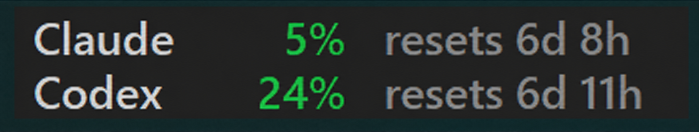

# AI Usage Widget (preview)

See your Claude and Codex usage and reset times without leaving the desktop. This
small Windows taskbar widget shows each provider's weekly percent used and the
time remaining in its current window. It is adapted from a personal multi-machine
overlay.

One source by default. Optional additional sources. No dashboard, web server,
telemetry, account credentials, paid API calls, or lab infrastructure required.



_Example taskbar display showing weekly percent used and the time remaining until
each provider's current window resets._

## Current support

- **Display:** Windows, PowerShell 7, multiple monitors; taskbar gap placement with
  a top-right fallback. Windows taskbar updates can change placement behavior.
- **Collector:** Python 3.10+, standard library; Windows or Linux.
- **Codex:** automatically reads recent local CLI transcript quota events. This is
  an observed CLI file format, not a stable provider API. CLI activity must have
  emitted a weekly rate-limit event; otherwise the widget shows `--`.
- **Claude:** when enabled, automatically runs Claude Code's native `/usage` command
  with no session persistence, tools or model turns, then caches the displayed
  percentage. Polls are throttled to once every 15 minutes. A compatible existing
  snapshot or manual reading remains a supported fallback.
- **Remote:** SSH to a trusted Linux/POSIX host with Python 3.10+. Uses your existing
  SSH authentication and verified host key. No remote installation or listener.
- Weekly subscription allowances only. API spend, context usage and model-specific
  limits are different measurements and are not inferred here.

## Quick start (Windows)

Install Python 3.10+, PowerShell 7 and the Claude Code CLI. Sign in to Claude Code
normally first; the widget neither reads nor stores its credentials. Extract the
package into a writable folder, then run these commands in PowerShell 7:

```powershell
pwsh -NoProfile -File ./Start-Widget.ps1
# Edit config.json if your CLIs run on another computer.
```

On first run the launcher creates `config.json` from the local-source example.
Keep the launcher running. Right-click a taskbar badge and choose Exit to stop
both the widget and its collector. Closing the launcher normally also stops its
collector. A forced process kill can leave the collector running; stop the exact
`python ... collect.py --watch` process if needed. No startup task is installed.
For the click-through top-right fallback, exit by closing the launcher window.

Use `-Position TopRight` to choose corner placement explicitly. Percentages are
**used**, not remaining. Green <50%, amber >=50%, red >=80%. Readings older than
two hours turn grey; expired windows show `--`. A reset countdown does not predict
how much allowance your next request will consume.

## Choose one source

Default `config.json` reads the current Windows user's Codex CLI history, refreshes
Claude through the installed CLI, and caches both readings locally. Set
`claude_cli` to `false` to use only an existing/manual Claude snapshot. For CLI
work on a remote Linux computer:

```json
{
  "sources": [{"name": "primary", "type": "ssh", "host": "my-ai-box", "claude_cli": true}],
  "refresh_seconds": 60
}
```

First verify `ssh my-ai-box` yourself and verify its host key. Configure credentials
through your normal SSH client/agent, never in this JSON file. The remote reader
uses only `~/.codex/sessions` and `~/.config/ai-usage-widget/quotas.json` by default.
Set `codex_home` or `quota_file` on a source to override those paths. Tilde refers
to the source computer's user. Remote paths use POSIX syntax. Relative `file`
paths refer to the collector's working directory; absolute paths are clearer.

For an existing compatible multi-host or minimal snapshot:

```json
{"sources": [{"name": "primary", "type": "file", "path": "C:/path/to/usage-data.json"}], "refresh_seconds": 60}
```

## Optional additional sources

Add entries to `sources`, each with a unique simple name. Local and SSH sources
can be mixed. Use sources for **the same provider account** only: the newest valid
reading wins independently for Claude and Codex. Percentages are never summed.
Separate-account aggregation is not supported. On a source failure the previous
valid reading keeps its original timestamp and becomes grey as it ages. The
local snapshot also reports `ok: false`; the badge alone does not show source errors.

The local collector examines the 100 most recently modified session files, at most
the last 2 MiB of each. An older quota event outside those bounds can be missed.
Refresh may be delayed by up to 45 seconds per unavailable SSH source. A file with
malformed/unsupported readings may successfully load but still show `--`.

## Claude refresh and manual fallback

With `"claude_cli": true`, the collector locates the installed Claude executable
and runs its authenticated `/usage` command. Guard hooks block prompt or tool
execution; a reading is accepted only when the CLI reports zero turns and zero
cost. The command is attempted at most once every 15 minutes. The collector still
runs every `refresh_seconds` interval, Codex events are reread each cycle, and the
overlay rereads the resulting snapshot every 30 seconds.

If automatic Claude refresh is unavailable, read the weekly usage and reset time
from Claude's own display. On the **source computer**, run (replace the example
values and timestamps):

```sh
python Import-ClaudeQuota.py --used 42 --reset 2027-01-07T18:00:00-07:00 --observed-at 2027-01-03T12:00:00-07:00
```

This creates `~/.config/ai-usage-widget/quotas.json`. `--observed-at` is when you
actually read the percentage. Updating a file must never make an old reading look
fresh. Keep updating it manually, or point `quota_file` at an existing trusted
producer's snapshot. Example minimal schema:

```json
{"claude": {"weekly": {"used_percent": 42, "resets_at": 1790000000, "observed_at": "2026-09-20T12:00:00Z"}}}
```

The timestamps above illustrate the schema; expired readings are ignored.
No token counts are converted into percentages, and no browser cookies or OAuth
files are read. The Claude CLI uses its existing authenticated session only for its
native usage display; the collector does not ask either provider's model a question.
On Windows outside `America/Phoenix`, install Python's `tzdata` package if the
collector reports that the displayed IANA timezone is unavailable.

## Privacy and troubleshooting

The collector reads transcript lines locally to find numeric Codex quota events.
Only numeric quota readings and observation timestamps leave a source host.
Your SSH host still sees your normal connection. Use trusted hosts and trusted
snapshot files. Do not expose your raw CLI transcript directory or auth files.

`config.json` and `usage-data.json` are ignored by Git. Do not publish your real
configuration, readings, usernames, transcript files, SSH config, or credentials.
Package releases from the explicit public-file allowlist in `package.py`.

For a diagnostic collection: `python collect.py --config config.json`.
For tests: `python -m unittest -v`.
A `--` means no current supported reading, not zero percent used. If SSH fails,
verify its alias, Python version, agent and host key directly. Native source
readings are snapshots and can lag the provider's current usage page.

## Development and release status

The existing personal widget remains separate. Fourteen focused collector tests
pass, including malformed/stale snapshots, provider selection, Claude parsing,
zero-turn command guards and refresh throttling. A local live check reproduced both
Claude and Codex readings. Linux live-source and Windows parser/process-smoke checks
were also completed. These are not a clean-machine installation acceptance test.
No claim of production readiness or signed installer.

MIT licensed. See [LICENSE](LICENSE). Copyright 2026 Mike Vasquez.
The overlay was adapted from the author's personal taskbar widget; the standalone
collectors and configuration examples are maintained in this repository.

Published preview: [digihax/ai-usage-widget](https://github.com/digihax/ai-usage-widget).
This is a snapshot display, not a provider API integration or billing tracker.
